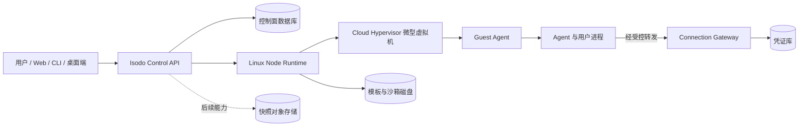

# Isodo

<p align="center">
  
</p>

<p align="center"><strong>给 AI Agent 一个安全、持久、可连接真实工具的工作空间。</strong></p>

Isodo 面向使用 AI Agent 开发软件和处理日常任务的个人用户。每个沙箱都是独立的工作空间：Agent 在隔离环境中运行，代码、文件和终端属于沙箱；用户通过任务组织工作过程，并可按授权连接外部服务。凭证由沙箱外的连接网关管理，不需要把长期密钥交给 Agent 或写入沙箱。

最终产品覆盖本地与云端沙箱。用户可以从用途模板创建环境，在任务中使用 Claude Code、Codex、OpenCode 等 Agent，检查终端和文件产出，保存文件与环境快照，并将快照上传后创建独立的云端沙箱。快照保存文件与环境，不包含运行中的内存状态；新沙箱需要重新授权外部连接。

## 产品能力

| 能力 | 最终形态 |
| --- | --- |
| 安全沙箱 | 隔离的 Linux 微型虚拟机，可选择本地或云端运行；进程、文件、网络和资源由沙箱边界约束。 |
| Agent 工作空间 | 在沙箱内运行用户选择的开发 Agent，通过任务查看过程、终端活动和文件产出。 |
| 安全连接 | 用户在沙箱外管理凭证，按沙箱授权外部服务；撤销授权后，后续调用被拒绝。 |
| 模板与快照 | 从用途模板创建环境；将文件和环境保存为快照，并可创建相互独立的新沙箱。 |
| 个人云端资源 | 以套餐管理云端计算和快照存储权益；模型额度由用户自己的服务连接提供。 |

## 架构方向



Control API 管理账号、沙箱资源与操作；Node Runtime 管理本机虚拟机、磁盘、网络和恢复；Guest Agent 提供安全的进程、PTY 与文件能力；Connection Gateway 在沙箱外执行获授权的外部调用。Nomad 部署平台服务和节点守护进程，单个沙箱由 Node Runtime 管理。

## 文档

- [产品概念与术语](docs/product-context.md)
- [产品决策](docs/product-decisions.md)
- [产品架构规格](specs/product-architecture.md)
- [服务实施计划](tasks/plan.md)
- [实施 TODO 与验收条件](tasks/todo.md)
- [沙箱 Runtime 技术规格](specs/isodo-sandbox-runtime-v0.1-spec.md)
- [规格索引与验证状态](specs/README.md)
- [模块与目录职责](specs/directory-responsibilities.md)
- [Guest Exec / PTY / Files 协议](specs/guest-protocol.md)
- [上游项目与许可证依据](specs/references.md)
- [参赛要求与交付核对](docs/competition-requirements.md)

## 仓库结构

```text
.
├── api/       # 对内 Guest 协议定义
├── docs/      # 产品概念、决策和交付说明
├── specs/     # 产品/服务架构、接口契约、验证依据
├── tests/     # 可复现的 Runtime 技术验证探针
├── artifacts/ # 探针日志与核验材料
├── tasks/     # 分阶段实施计划与验收清单
└── assets/    # Isodo 品牌素材
```
