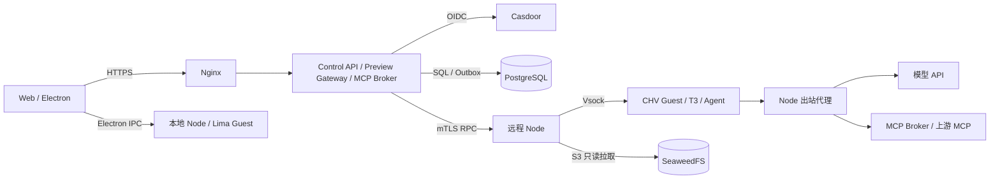

# Isodo

<p align="center"></p>

**让 AI Agent 在隔离、持久、可授权的工作空间中完成真实任务。**

Isodo 将沙箱、Agent 工作台、模型连接、MCP 和 Skill 放在同一个产品里。用户可以在 macOS 本地 Lima 或远程 Cloud Hypervisor 虚拟机中工作，授权自己的模型与工具连接，让 Agent 编写代码、运行测试、操作文件，并通过 HTTPS 预览服务。

[使用文档](https://docs.drowning.top:18443/docs) · [Web 控制台](https://web.drowning.top:18443/sandboxes) · [当前功能与验收](docs/current-status.md) · [架构与模块分工](docs-site/content/docs/concepts/architecture.mdx) · [路演与冻结清单](docs/roadshow.md)

> 托管演示环境通过 VPN/内部解析访问。文档站、代码合并和运行时部署分别管理，当前部署边界见[版本状态](docs/current-status.md#部署与代码版本)。

## 可以做什么

| 场景 | 当前能力 |
| --- | --- |
| 创建工作空间 | Web 管理远程 CHV；Electron 同时管理本地 Lima 和远程沙箱，支持创建、查询、启停、重命名和删除 |
| 使用真实 Agent | Guest 内运行 T3 工作台，管理任务、终端、文件和模型选择；Codex 已完成真实模型任务验收 |
| 管理文件 | 上传、下载、创建目录、查询元数据、目录分页、移动、删除，公开 Files API 限定 `/workspace` |
| 从 API 执行命令 | 远程 CHV Commands API 支持 argv、stdout/stderr、退出码、超时、取消与幂等 |
| 预览应用 | 通用 HTTP 端口默认 public，可按端口切换 private；支持 HTTP、WebSocket、SSE，管理端口始终受保护 |
| 连接 MCP | 市场、收藏、GitHub/Notion OAuth、沙箱绑定、Broker 工具调用；可添加无认证或 Bearer Token 的自定义 HTTPS MCP |
| 制作与使用 Skill | 制作个人 SKILL.md、收藏市场技能、为远程沙箱选择并同步到 Codex 技能目录 |
| 管理模型凭证 | 账号级加密保存配置，按沙箱授权；Guest 使用占位符，真实凭证在 Control/Node 可信边界管理 |
| 安装系统软件 | 新标准 Lima/CHV 沙箱内使用 Guest root；停止、启动保留工作盘，既有模板不会自动改变用户 |

本地与远程能力有明确差异：Commands/通用 Ports、市场 MCP/Skill 的本轮完整接入优先支持远程 CHV；工作台中的终端不等同于已公开独立 PTY API。快照流转、商业订阅及完整跨节点接管不属于本次路演的完成声明。详见[能力矩阵](docs/current-status.md)。

## 演示

<video src="https://github.com/user-attachments/assets/ed5cb878-9206-4775-a566-a4d9311ca7e7" controls width="960"></video>

[打开已有演示视频](https://github.com/user-attachments/assets/ed5cb878-9206-4775-a566-a4d9311ca7e7) · [预览图](assets/isodo-demo-preview.jpg)

建议路演顺序：创建云端沙箱 → 授权已有模型连接 → Agent 生成并测试代码 → 查看文件/终端 → 启动 HTTP 服务并预览 → 展示 MCP 与 Skill 的按沙箱授权。旧视频展示基础工作流；新增市场功能与最新版本请结合[路演步骤](docs/roadshow.md)演示。

## 整体架构



- **控制面**：Go HTTP API 负责认证、归属、模板固定、生命周期意图与 PostgreSQL Outbox；公开契约由 OpenAPI 生成 Go/TypeScript 请求绑定。
- **运行面**：Node 管理 VM、磁盘、journal 与 Guest 身份；Guest Agent 提供进程、文件和端口转发。云端使用 CHV/Vsock，本地使用 Lima。
- **访问面**：Nginx 提供 HTTPS 入口，Preview Gateway 经 Node RelayPort、Guest PortForward 访问应用；MCP Broker 保留上游凭证并校验沙箱绑定。
- **部署**：当前托管环境使用 Nomad/Docker 运行服务，systemd 管理 Node、Nginx 和文档站。核心异步编排使用 PostgreSQL Outbox。

源码、状态与持久化职责见[架构文档](docs-site/content/docs/concepts/architecture.mdx)；协议源位于 [api/openapi](api/openapi) 与 [api/proto](api/proto)。

## 本地启动

需要 Go 1.26.9、Node.js 24.13.1、pnpm 11.10.0、Docker Compose；运行本地沙箱还需要 macOS/Lima。远程 CHV 需要 Linux x86_64、KVM、匹配的 Cloud Hypervisor 与已发布模板。

```sh
make init
# 根据 .env.example 配置 Casdoor / GitHub 登录；秘密仅保存在受保护配置中。
make infra-up
cd app && corepack pnpm@11.10.0 install && cd ..
go build -o isodo-node ./cmd/isodo-node
mkdir -p .tools
# Apple Silicon 使用 arm64；Intel Mac 改为 amd64。
GOOS=linux GOARCH=arm64 CGO_ENABLED=0 go build -buildvcs=false -trimpath \
  -o .tools/isodo-guest-linux-arm64 ./cmd/isodo-guest
make agent-workspace-bundle
```

在不同终端启动：

```sh
make api
make web
make electron
```

默认 Web 为 `http://127.0.0.1:5734`，API 为 `http://127.0.0.1:8080`。Electron 自动管理自己的本地 Node，不要对同一 journal 另外启动 Node。首次准备 Base 需要安装依赖，完成后复用缓存。

- [快速开始](docs-site/content/docs/guides/quickstart.mdx)：认证、开发环境与第一个沙箱。
- [本地与云端接入](docs-site/content/docs/guides/runtime.mdx)：Preview origin、mTLS、Vsock 与远程模板。
- [部署说明](docs/deployment-drowning-top.md)：当前托管入口；发布 Web/Node 前执行[发布检查](docs/web-preview-release-checklist.md)。

## 开发者 API

API Key 通过 `X-API-Key` 发送，权限按操作分开授予：`sandboxes:read`、`sandboxes:write`、`sandboxes:execute`、`sandboxes:preview`。账号配置、MCP OAuth 等敏感操作要求账号会话。

```sh
export ISODO_API=https://api.drowning.top:18443
# ISODO_API_KEY 由安全环境注入，不粘贴真实密钥到文档或仓库。
curl -fsS -H "X-API-Key: $ISODO_API_KEY" "$ISODO_API/v1/sandboxes"
```

[中文 API 参考](docs-site/content/docs/api-reference/index.mdx) · [命令执行](docs/runtime-commands.md) · [文件](docs/runtime-files.md) · [HTTP 预览](docs/http-port-preview.md)

```sh
go test ./...
go vet ./...
make generate-check
npm ci --prefix docs-site
make docs-build
```

`make generate` 统一生成 Go/TypeScript、Proto 绑定与 API 文档，生成文件不手改。外部数据库、真实 CHV、真实模型/OAuth 测试需要各自环境与授权，不能用默认测试的跳过结果代替真实验收。

## 文档与交付

从[文档索引](docs/README.md)阅读当前版本。功能和验收以[当前状态](docs/current-status.md)、OpenAPI/Proto 和源码为准；过时的讨论及逐次联调日志从当前目录移除，仍可通过 Git 历史追溯。

本轮面向 **2026-11-04 路演**进入冻结准备，只整理文档、修复阻塞并核对演示，不扩展功能范围。已有 `v0` 基线保持指向 `05d0b8c`，实际贡献与过程以 Git 提交及 PR 为依据。
