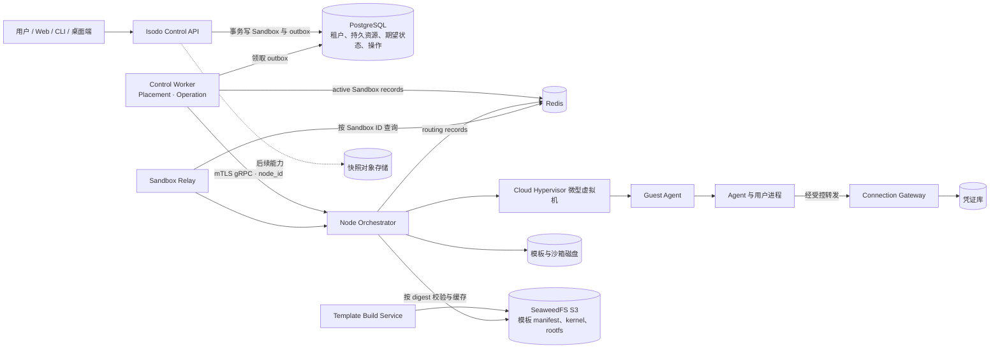

# Isodo

<p align="center">
  
</p>

<p align="center"><strong>给 AI Agent 一个安全、持久、可连接真实工具的工作空间。</strong></p>

Isodo 面向使用 AI Agent 开发软件和处理日常任务的个人用户。每个沙箱都是独立的工作空间：Agent 在隔离环境中运行，代码、文件和终端属于沙箱；用户通过任务组织工作过程，并可按授权连接外部服务。凭证由沙箱外的连接网关管理，不需要把长期密钥交给 Agent 或写入沙箱。

最终产品覆盖本地与云端沙箱。用户可以从用途模板创建环境，在任务中使用 Claude Code、Codex、OpenCode 等 Agent，检查终端和文件产出，保存文件与环境快照，并将快照上传后创建独立的云端沙箱。快照保存文件与环境，不包含运行中的内存状态；新沙箱需要重新授权外部连接。

## 产品能力

| 能力 | 最终形态 |
| --- | --- |
| 安全沙箱 | 隔离的 Linux 微型虚拟机，可选择本地或云端运行；进程、文件、网络和资源由沙箱边界约束。 |
| Agent 工作空间 | 在沙箱内运行用户选择的开发 Agent，通过任务查看过程、终端活动和文件产出。 |
| 安全连接 | 用户在沙箱外管理凭证，按沙箱授权外部服务；撤销授权后，后续调用被拒绝。 |
| 模板与快照 | 从用途模板创建环境；将文件和环境保存为快照，并可创建相互独立的新沙箱。 |
| 个人云端资源 | 以套餐管理云端计算和快照存储权益；模型额度由用户自己的服务连接提供。 |

## 本地 T3 沙箱开发

在两个终端分别启动 Lima Node 和 Control API；API 默认选择本地 Lima 后端：

```sh
make node-local-t3
make api
```

`make api` 会应用数据库迁移并生成仅用于本机 Node mTLS 的证书。登录后创建沙箱会写入 Control 数据库，再由 worker 调度到 Lima，Guest Ready 后启动 T3，并从沙箱卡片进入配对登录。本地沙箱支持 Stop（保盘）和 Start；T3 由 Guest 内 supervisor 托管。此路径使用 Lima 自带 Linux 基础环境，不会伪造 CHV/S3 模板记录；云端 CHV 创建仍要求 Registry 已发布 `linux-base` Ready build。首次运行还需要按 `.env.example` 配置本地 Casdoor 的 GitHub OAuth 应用。

## 云端 T3 沙箱

云端 CHV 使用内置 Node 24、T3 Server 和 Codex/Claude CLI 的 `base` 模板；构建与发布步骤见 [images/base/README.md](images/base/README.md)。发布后，用户可在创建沙箱时选择本地或云端、选择 `base`，打开沙箱即进入 T3；T3 自带终端、文件浏览/上传和 Agent 会话；沙箱支持 Stop 保盘与 Start 冷启动。

要由 Isodo API 签发公共应用/预览链接，在 `.env` 中启用 Preview Gateway：

```sh
# 本地单机（浏览器解析 *.localhost）
ISODO_PREVIEW_DOMAIN=localhost
ISODO_PREVIEW_SECRET=$(openssl rand -hex 32)
ISODO_PREVIEW_SCHEME=http

# 云端：wildcard DNS/TLS 指向 API
# ISODO_PREVIEW_DOMAIN=sandbox.example.com
# ISODO_PREVIEW_SECRET=<shared-random-secret>
# ISODO_PREVIEW_SCHEME=https
```

CHV 使用 Node `RelayPort`（API/Node 可分机），Lima 仍走同宿主 direct target。云端 Node 还需在宿主执行一次 `scripts/setup-chv-network.sh` 并设置 `ISODO_CHV_NETWORK_BRIDGE=isodo0`，否则 CHV 出网与云端创建会被拒绝。模块边界、真实 CHV 验证和未实现项见 [T3 云端运行时](docs/t3-cloud-runtime.md)，构建/发布/启动步骤见 [cloud-t3 runbook](docs/runbooks/cloud-t3.md)。契约与未实现边界见 [specs/sandbox-endpoints.md](specs/sandbox-endpoints.md)。

## 架构方向



Control API 在 PostgreSQL 事务中写入 Sandbox 与 outbox；Control Worker 领取 operation、完成 placement 后，使用 mTLS gRPC 将命令发送给指定 Node Orchestrator。Worker 将已确认运行的 Sandbox record 写入 Redis，Orchestrator 独立维护 Sandbox 到 Node 的 route record，PostgreSQL 保存持久租户与期望状态。Node Orchestrator 管理本机虚拟机、磁盘、网络和恢复；Guest Agent 提供安全的进程、PTY 与文件能力；Connection Gateway 在沙箱外执行获授权的外部调用。Redis 在线目录可从数据库分配关系与 Node journal 重建。Nomad 部署平台服务和节点守护进程，单个沙箱由 Node Orchestrator 管理。

## 文档

- [产品概念与术语](docs/product-context.md)
- [安全连接：持久规则与单次注入](docs/secure-connections.md)
- [产品决策](docs/product-decisions.md)
- [产品架构规格](specs/product-architecture.md)
- [Control API、Node gRPC 与 Redis 接入契约](specs/control-node-contract.md)
- [服务实施计划](tasks/plan.md)
- [实施 TODO 与验收条件](tasks/todo.md)
- [沙箱 Runtime 技术规格](specs/isodo-sandbox-runtime-v0.1-spec.md)
- [规格索引与验证状态](specs/README.md)
- [模块与目录职责](specs/directory-responsibilities.md)
- [文档站开发说明](docs-site/README.md)
- [Guest Exec / PTY / Files 协议](specs/guest-protocol.md)
- [上游项目与许可证依据](specs/references.md)
- [参赛要求与交付核对](docs/competition-requirements.md)

## 仓库结构

```text
.
├── api/
│   ├── openapi/   # 控制面与公开 HTTP 契约
│   └── proto/     # 当前 Guest RPC 契约
├── docs-site/     # Fumadocs 文档站，API Reference 从公开契约生成
├── cmd/           # Go 进程入口
├── internal/      # 控制面与运行时模块
├── migrations/    # 数据库迁移
├── deploy/        # Casdoor、PostgreSQL、Redis、SeaweedFS 与服务部署配置
├── scripts/       # 生成、环境配置和验证脚本
├── tools/         # API 代码生成工具配置
├── docs/          # 产品概念、决策和交付说明
├── specs/         # 人读的产品/服务架构、模块和研究规格
├── tests/         # 验证工具与跨模块测试
├── artifacts/     # 可核对的验证证据
├── prototype/     # 本地原型，当前由 .gitignore 排除
├── app/           # 本地 T3 派生多应用工作区，当前由 .gitignore 排除
├── tasks/         # 分阶段实施计划与验收清单
└── assets/        # 项目共用品牌素材
```
