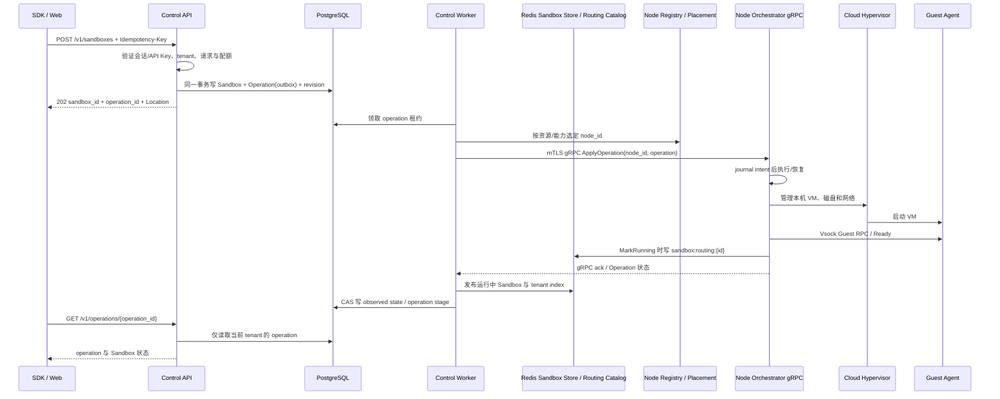

# Control API 与 Node RPC 接入契约

状态：2026-10-24，v0.1 规格草案，分阶段实现中。本文冻结真实 VM 接入时 Control API、数据库 operation/outbox 和单节点 Runtime 之间的责任与调用语义。HTTP 的机器契约仍以 `api/openapi/openapi-public.yaml` 为准；Node protobuf 由根目录 `make generate` 生成。当前仅实现 Node `GetNodeStatus` 的 mTLS gRPC 薄片；操作 journal、Apply/Get/Inspect/Watch、Node Registry、Worker 与 CHV 生命周期均未实现。

相关规格：[Sandbox CRUD 与鉴权](sandbox-crud-auth.md)、[Sandbox 生命周期](sandbox-lifecycle.md)、[Guest 协议](guest-protocol.md)、[目录职责](directory-responsibilities.md)。参考实现的版本和本地 checkout 见 [references.md](references.md)。

## 1. 参考取舍

| 参考 | 已核对实现 | Isodo 采用 | Isodo 不照搬 |
| --- | --- | --- | --- |
| E2B Runtime | API 验证 team、解析模板并选择节点，通过 gRPC `SandboxService.Create` 调用节点 Orchestrator；Create 等待 Guest `init` Ready 后返回 `201`。API 的运行中 Sandbox Store 写 Redis，Orchestrator 另写 `sandbox:routing:{id}`；Postgres 保存持久业务实体。`/v2/sandboxes` 的 `Idempotency-Key` 是可选、team 范围的 Redis reservation。 | 资源式 HTTP API、API 到节点 Orchestrator 的 gRPC、Redis 运行态 Sandbox Registry/租户索引、Orchestrator 所有的 Redis 路由目录、Postgres 持久元数据。 | Isodo 保留 DB operation/outbox 与异步 `202`，用于 VM 超过 HTTP 等待时长和跨进程恢复；Redis 不替代 Postgres 的租户/desired state，也不由 API 覆盖 Node 拥有的物理运行事实。 |
| Cocoon `sandboxd` | 单节点服务以 `POST /v1/claim` 接收 claim；尝试 `ClaimWarm`，warm miss 后转到 `ClaimProvision`，最后返回 sandbox id/token/deadline。它还提供 `sandboxd` 到 Guest `silkd` 的 HTTP Upgrade/vsock relay。 | Node 本地具备完整 VM 生命周期、磁盘/网络/Guest relay 的所有权；本地 journal 与重启 reconcile；将 Guest 数据通道与 VM 控制通道分开。 | `sandboxd` 的 claim token、租约、warm-pool 领取、memberlist 重定向不是 Isodo 公共 API 语义。v0.1 不做 warm pool，不让用户直接调用 Node 地址。 |

E2B 与 Cocoon 两种实现都把 HTTP/SDK 接口与 VMM 操作拆开，但对“谁选择 Node”有不同组织方式。Isodo v0.1 固定由 Control 的 placement 组件选定 Node，Node 上的 Orchestrator 只管理本机资源；多节点评分/容量算法后续实现，首个真实链路允许配置一个节点。

## 2. 信任边界与唯一所有者



| 能力/数据 | 唯一所有者 | 不允许的捷径 |
| --- | --- | --- |
| Casdoor 身份、tenant、API Key scope、配额、desired state、Node assignment、全局 operation | Control API/DB | Node 不接受用户 token，不从 HTTP body 信任 tenant_id。 |
| 本机 VM、CHV API socket、unit/cgroup、实例盘、TAP/netns、防火墙和本地 journal | Node | Control 不访问宿主 socket、文件系统、systemd 或 CHV API。 |
| VM 内 Exec/PTY/Files 与 Guest readiness | Guest Agent | Guest 不得接触宿主路径、CHV 控制 socket 或用户身份凭证。 |
| SDK 连接、PTY/Exec/Files 双向字节流 | Control/Gateway 到 Node relay，再到 Guest | 不通过生命周期 RPC 传输交互流，也不向客户端暴露 Node 内网地址。 |
| 在线 Sandbox Registry 与 tenant index | Control Worker 写 Redis；仅记录已确认运行中的实例 | Redis 故障时不能假造 running；Redis 是可重建运行态目录，不承载唯一租户/配额事实。 |
| Sandbox 到 Node 的运行路由 | Node Orchestrator 写 Redis；在 Guest Ready/MarkRunning 后登记，在 MarkStopping/退出时删除 | API 不抢写路由；过期/旧 execution 的删除不得清除新一轮运行的 route。 |

Control→Orchestrator 使用 gRPC 双向 TLS。Node 证书身份必须映射到注册的 `node_id`；请求中的 `node_id` 只用于交叉校验，不能覆盖证书身份。Worker 只能向 placement 指定且 DB 已分配的 Node 发命令。Node 对每条命令校验本地 Sandbox journal 中的 `sandbox_id`、`ownership_generation` 和单调 `revision`；旧 generation/revision 拒绝执行。HTTP handler 不直接创建 gRPC connection，也不拼接任意请求地址；由独立的 Orchestrator client/Node registry 管理连接和重试。

v0.1 每个 Sandbox 固定一个 Node。Node 离线时，操作保持可观察的 pending/unknown，不自动新分配另一台 Node，不因 Control RPC timeout 推断原 VM 已死。

### 2.2 Node Orchestrator 如何连接

- Control Worker 的 `NodeRegistry` 把 `node_id` 映射到私网 gRPC target、TLS server name、证书身份、能力/资源报告和 `last_seen_at`。target 来自受信部署配置/注册表，不接受用户请求参数。
- 本地单节点开发使用固定 `127.0.0.1:9090` target 与本地开发 CA；生产 Nomad 通过 Consul/Nomad 服务发现获得节点私网 target，再校验 mTLS 证书 SAN 与注册 `node_id`。不在公网暴露 9090。
- `internal/control/orchestrator` 持有按 `node_id` 复用的 gRPC `ClientConn`，配置 TLS、keepalive、最大消息大小和有限 RPC deadline；它向 Worker 暴露 typed client，不把 gRPC 细节放进 HTTP handler。
- v0.1 首个真实链路可静态配置一个 Node；placement 仍经同一个 registry/client 接口，以后增加节点筛选不改公开 API。调度依据 Node 能力、可用 CPU/RAM/磁盘和 draining 状态；Node `RESOURCE_EXHAUSTED` 且确认尚未写 intent 时可换候选，任何 outcome unknown 都必须先 Inspect 原 Node。
- Control 每 5 秒调用 `GetNodeStatus` 刷新版本、capacity、capabilities、draining 与 `last_seen_at`；20 秒无成功探测从新建 placement 候选中摘除，但保留既有 Sandbox→Node assignment，不迁移其盘或重建 VM。

### 2.1 Redis 运行态与路由记录

Redis 是 Runtime 的必需基础设施，不只是可选缓存。职责按 E2B 分成两类记录，写入者不同：

| Isodo Redis record | 目标 key | 写入者 | 内容与读者 | 生命周期 |
| --- | --- | --- | --- | --- |
| 运行中 Sandbox record | `isodo:sandbox:runtime:{tenant_id}:item:{sandbox_id}` | Control Worker | `tenant_id`、`sandbox_id`、`node_id`、`execution_id`、`boot_id`、`started_at`、`expires_at`、资源摘要；Control 用于 active list/status，后台清理器用于到期扫描 | 仅 observed 为 running 时存在；record 保存 `expires_at`，由 expiration sweeper 清理，不靠 Redis key TTL 脱离 tenant index |
| Tenant runtime index | `isodo:sandbox:runtime:{tenant_id}:index` | Control Worker | 在线 Sandbox ID 集合，供按租户列举/恢复运行态 | 与 record 的写入/删除用 Lua 原子维护；两 key 使用相同 tenant hash tag；不把 index 当权限依据 |
| Routing record | `isodo:sandbox:routing:{sandbox_id}` | Node Orchestrator | `node_id`、内部 gRPC/relay target、`execution_id`、`boot_id`；Gateway/relay 按 Sandbox 路由 | Guest Ready 后登记；Stop/Delete/crash 后按 execution_id 条件删除，TTL 是最后防线 |
| Expiration index | `isodo:sandbox:runtime:expiration` | Control Worker | ZSET，member 为 `tenant_id:sandbox_id:execution_id`，score 为 Unix 毫秒过期时间 | Create/更新/删除时维护；清理器按范围扫描，不遍历所有 keys |

`execution_id` 每次真实运行生命周期唯一。普通删除与更新用 Redis Lua 脚本校验当前 execution 再变更；旧 Stop/Crash 的延迟清理只能移除自己那一代记录。运行中 Sandbox JSON 与 tenant index 必须原子写入/删除。Expiration ZSET 使用 `tenant_id:sandbox_id:execution_id` 做 member，单独维护并由 healer 对账，避免跨 Redis Cluster hash slot 的脚本事务假设。

PostgreSQL 保存长生命周期 Sandbox 资源、tenant owner、desired state、模板/资源规格和 operation；Redis 保存 E2B 风格的 active runtime 快照与在线租户索引；Redis routing record 决定请求当前应去哪个 Node；Node journal/CHV 检查才是本机是否真实存在 VM 的证据。API `GET/List` 从 DB 做 tenant 授权/资源清单，再合并 Redis 在线态；Redis miss 不能单独证明 VM 已停止，状态无法确认时呈现 `unknown` 并触发 Node inspect/reconcile。

Redis 丢数据后由 DB assignment + Node journal/Inspect 重建运行态记录和 route；重建前不把 Sandbox 暴露为可路由 running。Redis 不可用时不接收新的真实创建/状态转换；已运行 VM 不因 Redis 故障被强杀，但操作保持 pending/degraded，路由恢复前 Gateway 返回可重试的服务不可用。Redis 必须配置持久/高可用策略、容量、淘汰策略与监控；禁止对这些 key 使用会静默淘汰运行态记录的 `allkeys-*` 策略。v0.1 开发 Compose 使用 AOF 与独立 volume。

## 3. 公共 HTTP API

公开 API 沿用 E2B 易理解的资源路由和清晰的 JSON 字段；保持 Isodo 的 tenant 鉴权、`error.code/message` 响应和异步 operation 语义。公共 API 使用 OpenAPI 描述与生成客户端，不在 handler 手写第二份请求/响应定义。

### 3.1 资源接口

| 方法与路径 | 用途 | v0.1 响应 |
| --- | --- | --- |
| `POST /v1/sandboxes` | 创建真实 Sandbox，并原子记录配额预留与 Create operation | `202 Accepted`；响应含 `sandbox_id`、`operation_id`、初始状态；`Location: /v1/operations/{operation_id}` |
| `GET /v1/sandboxes` | 按当前 tenant 分页查询；筛选只应用于本 tenant | `200`，cursor 分页；默认 50、最大 200 |
| `GET /v1/sandboxes/{sandbox_id}` | 查询 Sandbox 的 desired/observed state、health、固定资源规格、时间及最后 operation | `200`；跨 tenant 与不存在同样返回 `404` |
| `PATCH /v1/sandboxes/{sandbox_id}` | 只修改显示用 `name`/`metadata`；不改变模板、资源、网络和 Node assignment | `200`；ETag/revision 条件冲突返回 `409` |
| `POST /v1/sandboxes/{sandbox_id}:start` | 对原 Node 和原磁盘冷启动 | `202` 与 operation；已运行时返回成功 no-op operation |
| `POST /v1/sandboxes/{sandbox_id}:stop` | 停止 VM，保留实例盘 | `202` 与 operation；已停止时返回成功 no-op operation |
| `DELETE /v1/sandboxes/{sandbox_id}` | 停止并删除该 Sandbox 拥有的 VM/网络/实例盘 | `202` 与可查询 operation；资源确认回收前不得回 `deleted` |
| `GET /v1/operations/{operation_id}` | 查询当前 tenant 可见的异步操作 | `200`，包含阶段、时间、attempt、结果/错误、cleanup_pending |

创建请求是版本化且可审计的资源规格，不接受任意 Node、宿主路径、systemd unit、CHV 参数或命令：

```json
{
  "template_id": "tpl_...",
  "template_build_id": "build_...",
  "resources": { "vcpu": 2, "memory_mib": 2048, "disk_mib": 10240 },
  "network": { "allow_internet_access": true },
  "name": "agent-task",
  "metadata": { "project": "demo" }
}
```

用户用稳定的 `template_id` 选择模板，可选 tag/版本由 Control 校验权限并解析成不可变 `template_build_id`。Create 后持久化这两个 ID；Node 只接收固定 build ID，不接收可漂移 tag。Build manifest 中的 SHA-256 digest 只校验产物，不充当模板选择器。字段校验和允许范围由 OpenAPI `CreateSandbox` schema 与模板 manifest 一起固定。公网出口沿用 [网络安全规格](network-security.md) 的规则；Node 不接收任意 CIDR/宿主网络对象，除非公开 schema 明确暴露且通过安全约束。

所有 Sandbox mutation（Create、PATCH、Start、Stop、Delete）必须携带 `Idempotency-Key`（1–128 个可见 ASCII 字符）。作用域为 `tenant_id + HTTP method + canonical path + key`，并绑定规范化 request hash。同键同请求返回原结果；同键不同请求返回 `409 IDEMPOTENCY_KEY_REUSED`。记录至少保留 24 小时，未完成操作不可清除。PATCH 另外用 ETag/If-Match 解决并发编辑；其目的不同于请求幂等键。

### 3.2 Operation 响应形状

```json
{
  "sandbox_id": "sbx_...",
  "operation_id": "op_...",
  "status": "queued",
  "sandbox": { "desired_state": "running", "observed_state": "requested" },
  "links": { "sandbox": "/v1/sandboxes/sbx_...", "operation": "/v1/operations/op_..." }
}
```

Operation 状态限定为 `queued | running | succeeded | failed | cancelled`；`stage` 独立表达 `reserve | materialize | network_prepare | launch | guest_ready | publish | stop | delete | cleanup`。成功只在 Node 真实核验目标后提交。HTTP 客户端断开、网关超时或 Worker 租约过期不取消操作。客户端通过 `Location` 查询；后续可增加 SSE/WebSocket 通知，但轮询 API 是 v0.1 基础保证。

### 3.3 错误

HTTP 错误继续使用：

```json
{ "error": { "code": "NODE_UNAVAILABLE", "message": "Sandbox node is temporarily unavailable." } }
```

必须稳定区分 `UNAUTHENTICATED`、`FORBIDDEN`、`NOT_FOUND`、`INVALID_ARGUMENT`、`IDEMPOTENCY_KEY_REUSED`、`OPERATION_IN_PROGRESS`、`SANDBOX_DELETING`、`QUOTA_EXCEEDED`、`NODE_UNAVAILABLE`、`CAPABILITY_UNSUPPORTED` 和 `INTERNAL`。上游内部错误、宿主路径、命令行、凭证、Node 地址不回传公开响应。异步操作失败写入 Operation 的稳定 code 和可公开安全说明；原始错误只进入脱敏内部日志。

返回 `202` 后的 Node 或 Guest 故障写在 Operation，不把已接受请求改成同步 HTTP 错误。`429` 只表示 Control 能确认的配额拒绝；Node 无法确认实例事实时保留 pending/unknown，不释放占用并返回“成功删除”。

## 4. Control API ↔ Node Orchestrator gRPC

正式机器定义放在 `api/proto/isodo/node/v1/node.proto`，版本化包名 `isodo.node.v1`。只用 protobuf 定义传输类型；生成文件必须由根目录 `make generate` 产生。Node RPC 是内部接口，不加入 `openapi-public.yaml`，不展示在公开 API 文档站。

### 4.1 RPC 集合

| RPC | 方向/用途 | 必须语义 |
| --- | --- | --- |
| `ApplyOperation(ApplyOperationRequest) -> ApplyOperationResponse` | Control Worker 经 placement 调用指定 Node Orchestrator，下发 Create/Start/Stop/Delete | Orchestrator 将 intent 持久写 journal 后才确认 `accepted`；同 operation 重放返回已有状态并续做，不重复创建资源。 |
| `GetOperation(GetOperationRequest) -> GetOperationResponse` | Control 恢复丢失回复或轮询 Node | 以 `operation_id` 与 `request_hash` 返回 Node 持久阶段/结果；未知 operation 返回 `NOT_FOUND`，不能当作未发生副作用的证明。 |
| `InspectSandbox(InspectSandboxRequest) -> InspectSandboxResponse` | Control 对账真实节点状态 | 返回 journal 和 CHV 核实的资源 inventory/state；失联不是 `stopped`。 |
| `GetNodeStatus(Empty) -> NodeStatus` | Control 发现/探测目标 Orchestrator | 返回节点 boot identity、协议版本、CHV/Guest 能力、capacity、draining；Control 用 last_seen 与 DB assignment 判定新建 placement。 |
| `WatchOperation(WatchOperationRequest) -> stream NodeEvent` | Control Worker 订阅某个已接受 operation 的状态 | 事件含 node、sandbox、operation、generation、revision 和单调序号；断线可重连，丢事件后以 `GetOperation`/`InspectSandbox` 补齐。 |

`ApplyOperation` 请求最少包含 `operation_id`、`request_hash`、`sandbox_id`、`ownership_generation`、`revision`、`action` 和对应的完整资源/网络期望。Create 还含模板 digest、资源规格、受限网络策略及由 Control 生成的非秘密参数。不得传递 GitHub/Casdoor token、用户 API key、原始 connection secret、任意 shell 命令或文件路径。

响应只用于传递持久接收状态：`accepted`、`already_applied` 或明确拒绝及稳定错误码。完整操作可能仍在 Node 执行；它的结果必须可通过 `GetOperation`、`InspectSandbox` 或带 sequence 的事件恢复。RPC response 丢失后，Control 用同一 `operation_id` 重试/读取，禁止 mint 新 Sandbox ID。Orchestrator 进入 `running` 时独立发布 routing record；Control Worker 观察到相同 execution 已 Ready 后，再原子发布 Redis runtime record/index。两类写入采用不同 key、各自可重试，不能一个写者假装代表另一个写者成功。

### 4.2 Node 幂等与 fencing

- Node 持久化 `operation_id -> request_hash, sandbox_id, action, generation, revision, stage, result`。同 operation/hash 返回既有状态；同 operation ID 不同 hash 返回 `FAILED_PRECONDITION`。
- `ownership_generation` 改变表示全局 owner 变更；首版固定 Node 时不做自动改变。`revision` 在单个 Sandbox 内严格递增，旧 revision 返回 `STALE_REVISION`。操作开始和每个不可逆副作用前都比较最新 revision。
- 操作采用 Node 本地 sandbox lock 串行。Delete 可 supersede Create/Start/Stop，但仅改变目标和后续清理，不宣称旧副作用没有发生；必须收敛至 deleted 或保持 cleanup pending。
- `boot_id` 每次真实 VMM 启动变化；`guest_epoch` 每次 Guest Agent 生命周期变化。它们是 Node 观测结果，不接受客户端指定。Stop/Start 与 Agent restart 的细节服从生命周期规格。
- 每个副作用先写 `intent`，成功核验后写 `observed`。Node restart 后以 journal、独立 systemd unit、CHV socket 与磁盘身份一起核对；不得单靠 PID、目录名或 RPC ack 推断 VM 状态。

### 4.3 身份、deadline 与可用性

- gRPC 使用双向 TLS，服务端证书校验 Worker 服务身份，Node 客户端证书映射唯一 `node_id`。开发环境可使用本地 CA；不能用共享静态 bearer token 代替节点身份。
- 每个 RPC 都设有限 deadline；默认 10 秒只限制单次传输等待。Create/Ready 总预算 120 秒、模板物化预算 300 秒由 operation worker/Node 阶段记录实施，RPC deadline 不取消持久任务。
- Worker 租约、RPC deadline、VM boot deadline 和用户 API 等待 deadline 是不同计时器。租约过期后新 Worker先查询相同 operation，禁止并发启动第二份命令。
- Node 对本地 VMM、磁盘、网络和 Guest 问题映射固定 gRPC status + `error_code`；不得把 CHV 私有错误详情透传到公开 API。

## 5. 首版真实创建的执行与恢复

1. API 验证身份、tenant scope、模板 digest、资源上限、网络策略和 Idempotency-Key。
2. 单个 DB 事务创建 `requested` Sandbox、固定 `node_id`/`ownership_generation`、配额 reservation、revision=1 的 operation/outbox 和幂等记录。事务失败时不能调用 Node。
3. Worker 租约领取 outbox；placement 选出有兼容能力/容量的 Node，通过 mTLS gRPC 调用其 Orchestrator `ApplyOperation(Create)`。首个真实链路可由配置固定一个 Node；后续通过 heartbeat/capacity registry 做 E2B 风格候选筛选。
4. Node 校验 assignment/fencing，写 journal intent；按模板/盘→网络隔离→VMM unit→Guest Ready 的顺序执行。具体补偿以 [生命周期规格](sandbox-lifecycle.md) 为准。
5. Orchestrator 在 Sandbox 进入 live/running 时发布 Redis routing record；Control Worker 观察到同一 execution 的 Guest Ready/Node inventory 后写运行中 Sandbox record 与 tenant index。Redis 是必需步骤；只有 Node Ready、路由已登记且 active record 成功，才标记 `running` 和 operation `succeeded`。
6. Control/Node/Guest 任何阶段崩溃都以同一 Sandbox、operation、generation 和 revision reconcile。回复不确定时先 `GetOperation` / `InspectSandbox`，不新建 ID、不猜测资源不存在。

首版真实 CRUD 的定义：Create 真实创建 VM；Get/List 返回 Control 的持久 desired state 和 Node 最近核实的 observed state；Patch 只改 metadata/name；Stop 保盘关机；Start 原盘冷启动；Delete 在确认 VMM、网络与实例盘清理后完成。若只是写 PostgreSQL 行，必须标作 metadata CRUD，不能描述为真实 Sandbox CRUD。

## 6. 持久模型补充

Operation 至少含：`id, tenant_id, sandbox_id, node_id, action, request_hash, idempotency_key_hash, ownership_generation, revision, status, stage, attempt, lease_owner, lease_expires_at, created_at, updated_at, result, error_code, cleanup_pending, needs_attention`。原始 Idempotency-Key 可哈希存储；operation 对用户查询始终 tenant-scoped。

Sandbox 持久字段至少含：`id, tenant_id, template_id, template_build_id, resource_spec, network_spec, node_id, ownership_generation, revision, desired_state, observed_state, health, boot_id, guest_epoch, last_node_seen_at, last_confirmed_state, created_at, updated_at, deleted_at`。模板、Build、资源/网络规格在 Create 后不可 Patch；若未来需要 resize、迁移或换模板，使用显式新 operation 并另行规格化。

DB 事实与 Node 事实分开：Control DB 是期望状态、租户归属和 operation 的全局来源；Node journal/CHV 检查是该节点本地实际资源的证据。Node event 是观测更新，不得反向授予 tenant 权限或改变资源 owner。

## 7. 实现拆分与验收

| 阶段 | 工作 | 完成证据 |
| --- | --- | --- |
| T1.1 契约冻结 | 更新 `openapi-public.yaml`，新增 `api/proto/isodo/node/v1/node.proto`；纳入 `make generate`，生成公开 API 和 Node gRPC Go 绑定/文档 | OpenAPI 和 proto 均可生成；破坏性字段改动有版本策略；API reference 不暴露内部 Node RPC。 |
| T3.1 Node Orchestrator MVP | 单 Node gRPC server、mTLS、journal、CHV supervisor、operation 幂等/inspect、Redis route publisher | 重复 RPC、错误 generation、Node restart、CHV/Guest readiness、route publish/删除与 Redis 故障恢复在真实 Linux/KVM 主机验证。 |
| T4.1 Control API / Worker | DB outbox/lease、Node registry/placement、gRPC 连接池、Redis active Sandbox Store/index、operation 查询与 reconcile | DB/Redis 集成及真实 Node 垂直链路；跨 tenant operation 404；timeout 后查询而非重复创建；Redis 主从/重启后重建。 |
| T5 后续 | Gateway、持久化连接授权、对象存储 Snapshot、多节点 | 不阻塞首个真实 Sandbox Create/Stop/Start/Delete 链路。 |

真实链路验收至少覆盖：两个租户相互不可见；Create 同键并发仅一个 Sandbox/unit；Node journal 写入后断电/杀进程重启不重复建 VM；Create 进行中 Delete 最终清干净；Node 离线/回复丢失时状态 unknown 而非 stopped/deleted；Stop/Start 保留文件并创建新 boot_id；Guest Ready 和出口拒绝策略失败不发布 running；Delete 清理未确认不释放磁盘配额。

本文是尚未实现的契约规格。验收项不是已执行测试的陈述；验证方式遵守 [验证计划](validation.md)。

## 8. 参考源码（固定 commit）

- E2B Control → Orchestrator 流程：[架构文档 Sandbox creation](https://github.com/e2b-dev/infra/blob/6b82caf690b06fb983254714187dc496ac4d0cec/docs/ARCHITECTURE.md#sandbox-creation)、[sandbox_create.go](https://github.com/e2b-dev/infra/blob/6b82caf690b06fb983254714187dc496ac4d0cec/packages/api/internal/handlers/sandbox_create.go)、[orchestrator.proto](https://github.com/e2b-dev/infra/blob/6b82caf690b06fb983254714187dc496ac4d0cec/packages/orchestrator/orchestrator.proto)。
- E2B API 运行态 Redis Sandbox Store：[Redis operations](https://github.com/e2b-dev/infra/blob/6b82caf690b06fb983254714187dc496ac4d0cec/packages/api/internal/sandbox/storage/redis/operations.go)、[atomic scripts](https://github.com/e2b-dev/infra/blob/6b82caf690b06fb983254714187dc496ac4d0cec/packages/api/internal/sandbox/storage/redis/scripts.go)。
- E2B Orchestrator-owned route：[routing publisher](https://github.com/e2b-dev/infra/blob/6b82caf690b06fb983254714187dc496ac4d0cec/packages/orchestrator/pkg/routing/publisher.go)、[Redis catalog](https://github.com/e2b-dev/infra/blob/6b82caf690b06fb983254714187dc496ac4d0cec/packages/shared/pkg/sandbox-catalog/catalog_redis.go)。
- Cocoon sandboxd API 和 claim 实现：[server.go](https://github.com/cocoonstack/sandbox/blob/2654727931532a37f952bf8b7c44bcb8ce8b9cff/sandboxd/server/server.go#L319)、[api.go](https://github.com/cocoonstack/sandbox/blob/2654727931532a37f952bf8b7c44bcb8ce8b9cff/sandboxd/server/api.go)、[pool/claim.go](https://github.com/cocoonstack/sandbox/blob/2654727931532a37f952bf8b7c44bcb8ce8b9cff/sandboxd/pool/claim.go)。
- Cocoon guest relay/服务组成：[sandbox README](https://github.com/cocoonstack/sandbox/blob/2654727931532a37f952bf8b7c44bcb8ce8b9cff/README.md)、[silkd 服务](https://github.com/cocoonstack/sandbox/blob/2654727931532a37f952bf8b7c44bcb8ce8b9cff/silkd/src/server.rs)。

检查时参考仓库为用户本地 checkout；本文不依赖其未锁定的主分支，也未执行参考项目测试。E2B 创建流程是同步等待 Ready；Isodo 使用异步持久 operation 是明确的本地设计决策。
