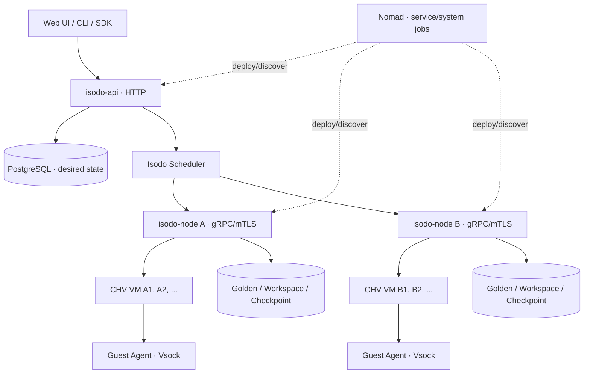

# Isodo Sandbox Runtime — Technical Specification v0.1

> **状态**：Draft v0.2 / v0.1 实现目标；CHV/Vsock 最小探针已验证，正式 Runtime 尚未实现<br>
> **日期**：2026-10-24<br>
> **方向**：基于 Cloud Hypervisor 自研 Linux MicroVM Sandbox Service；参考 Cocoon Engine 的 VM 生命周期设计、E2B 的 API / Orchestrator / Guest Agent 分层；通过 Nomad 部署平台服务及宿主节点守护进程。<br>
> **设计原则**：安全沙箱是产品，不是把 Kata、Cocoon 或 E2B 换一层 HTTP API。优先建立可核验的隔离与执行边界，按实际剩余时间收敛交付。

本文件基于用户提供的完整 Markdown 修订。上游依据、固定 commit 和代码阅读范围见 [参考项目](references.md)；目录职责见 [目录与模块](directory-responsibilities.md)。示例均为待实现契约，不是已可运行配置。

服务行为主要参考 E2B。2026-10-24 的网络、执行断连与数据生命周期收敛结果见 [service-behavior.md](service-behavior.md)；以下相关旧草案已同步修订。

## 0. 范围与非目标

### 当前执行范围（用户于 2026-10-24 确认）

先完成沙箱服务；桌面端规格及 T3 工作台集成延后。当前交付聚焦 API、Node、Guest、Exec/PTY/Files、持久化、网络边界和部署恢复。先通过 API/测试客户端验收，不以桌面端完成为前置条件；首个 Agent 的交互适配不阻塞基础服务。常规服务行为以 E2B 为主，已在详细服务规格固定，不再作为待用户回答的访谈题。


### MVP 要实现（P0）

- 独立的 Isodo HTTP API：创建、查询、列表、停止、启动、删除沙箱；身份鉴权和资源配额。
- 每个沙箱一台真正的 Cloud Hypervisor VM，独立 Guest Linux Kernel、系统盘和工作目录。
- Linux Guest Agent：命令执行（stdout、stderr、exit code、timeout）、交互式 PTY（stdin、output、resize）、文件上传下载。
- 不依赖 Kubernetes：Nomad 部署 API / Node Agent；Node Agent 管理本机所有 Sandbox VM。
- 预构建、不可变、按 CPU 架构区分的 Golden Image；本地缓存和独立可写盘。
- 默认允许公网出口，支持显式关闭/限制，阻断宿主和内部地址；基础资源限制与访问控制；操作审计和异常资源回收。
- 所有成功状态可通过真正的 VMM / Guest / 存储状态核验。

### MVP 明确不承诺（P1/P2）

- 完整 VM 内存 Pause/Resume、增量内存快照、UFFD 懒加载、Fork、跨节点无损迁移。
- 公网开放的生产级多租户安全保障、成熟账单系统、自动扩缩容。
- OCI Dockerfile 到可启动 VM Golden Image 的通用构建流水线（v0.1 只消费预构建 VM 镜像）。
- macOS VZ 后端；跨 ARM64/AMD64 的运行态迁移。
- 完整 Secretless LLM/MCP Gateway（最小受控模型出口与一种真实 MCP 工具调用列为 P0，通用兼容列为 P1）。

## 1. 架构与职责



**Control Plane `isodo-api`**：鉴权、项目/用户、配额、模板目录、节点选择、Sandbox desired state、幂等、对外 REST/流式接口、审计。

**Node Runtime `isodo-node`**：一台物理/虚拟 KVM 宿主运行一个实例；创建 VMM、管理 CHV API Unix Socket、分配本地磁盘/网络/cgroup、通过 Vsock 调用 Guest、进程状态 Reconcile、资源回收。

**Guest `isodo-guest`**：由 systemd 在 VM 内启动；执行进程、PTY/Session、文件读写和健康检查。Guest 是低信任环境；宿主不能接受 Guest 自报的权限决定。

**Nomad**：只管理 `isodo-api`、`isodo-node` 以及后续的 `isodo-builder`、`isodo-proxy` 等宿主服务。**一个用户 Sandbox 不创建一个 Nomad Job**。Nomad 既不负责 Sandbox 生命周期，也不直接访问每个 CHV Unix Socket。

**存储分离**：PostgreSQL 存控制面的逻辑状态；Node 本地 SQLite/Journal 记录 VMM 进程、磁盘、socket 和独立 ownership generation；对象存储是未来缓存与快照的持久化目的地。

### 1.1 关键不变量

1. 每个 `sandbox_id` 在任意时刻至多有一个可写所有者，所有操作带 `generation` / fencing token。
2. 同一沙箱的 Stop/Delete/Snapshot/Clone 操作串行化；API 幂等；中途失败可重试或补偿。
3. VM 模板文件是不可变的；实例只写自己的可写盘。Snapshot 被引用时不能 GC。
4. Guest 内不注入控制面永久凭证；Guest 不可直接操作 CHV API Socket。
5. Nomad 更新或重启 `isodo-node` 时，**不直接杀死由它管理的所有 CHV 进程**；由宿主独立生命周期单元承载 VMM，Node Agent 重启后接管（adopt）。
6. `running` 必须包含 CHV 存活且 Guest Agent Ready；只有 VMM 进程存在不代表 Sandbox 可用。

## 2. 组件与源码布局

```text
isodo/
├── cmd/
│   ├── isodo-api/           # 对外 HTTP / WS
│   ├── isodo-node/          # 宿主节点 gRPC + reconcile
│   ├── isodo-guest/         # Guest 内 Agent
│   ├── isodo-gateway/       # 受控模型/MCP 与凭证边界
│   └── isodo-builder/       # P1: Golden Image Builder
├── app/apps/web/           # 本地 T3 派生 Web 工作区，当前未纳入提交
├── api/openapi/
│   ├── openapi.yaml                  # 控制面/管理 API
│   └── openapi-public.yaml           # 用户与 SDK 的 Sandbox API
├── api/proto/isodo/guest/v1/guest.proto  # 已定义；Node 契约另行展开
├── internal/
│   ├── control/{api,auth,scheduler,quotas,repository}/
│   ├── node/{service,vm,reconcile,storage,network,security}/
│   ├── vmm/cloudhypervisor/{process,client,config,snapshot}/
│   ├── guest/{exec,pty,files,session}/
│   ├── template/{manifest,cache,builder}/
│   ├── gateway/             # 授权、上游适配、凭证使用
│   └── protocol/            # 跨组件最小共享契约
├── deploy/nomad/{api.nomad.hcl,node.nomad.hcl}/
├── config/{api.example.yaml,node.example.yaml}/
├── images/ubuntu-agent/{Dockerfile,build.sh,init/}/
└── tests/{unit,integration,e2e,security}/
```

v0.1 可以把 API、Scheduler 放在一个 Go 二进制中，Node Agent 放在另一个二进制中；不要因为画了多个组件就拆成十几个独立微服务。

## 3. 需求清单

| ID | 需求 | 优先级 | 验收依据 |
|---|---|---|---|
| R-01 | Sandbox CRUD + Casdoor 鉴权 | P0 | 任何用户不能读取、修改或删除其他 tenant 的 Sandbox；契约见 [R-01 规格](sandbox-crud-auth.md) |
| R-02 | CHV Process Lifecycle | P0 | API 状态与真实 CHV 进程 / API 一致 |
| R-03 | Guest Exec | P0 | stdout、stderr、exit code、超时和取消正确 |
| R-04 | PTY / Web Terminal | P0 | 可启动 bash/codex，支持 Ctrl+C、resize |
| R-05 | Files | P0 | 上传、下载、读取、删除，路径受限 |
| R-06 | Golden Image | P0 | 由 version/digest 创建，实例相互不污染 |
| R-07 | Disk Workspace Persistence | P0 | 停止重启后系统盘和工作区仍在；删除回收实例盘，独立持久卷延后 |
| R-08 | Network Isolation | P0 | 默认公网可用；关闭/限制出口生效，宿主及内部地址不可达 |
| R-09 | Node Reconcile / GC | P0 | Node Agent 重启可以重新发现正在运行的 VM |
| R-10 | Nomad Deployment | P0 | 节点服务可通过 System Job 部署、滚动更新 |
| R-11 | Workspace Checkpoint | P1 | 停机状态下存储快照可以恢复文件 |
| R-12 | VM Memory Snapshot / Resume | P1 | 恢复此前在运行的进程状态，含一致磁盘 |
| R-13 | Template Builder | P1 | Dockerfile/Recipe → 可启动 Linux VM Template |
| R-14 | 最小 Secretless Gateway | P0 | 一种模型连接及一种 MCP 工具真实调用；第三方 Token 不进入 Guest，撤销后新调用拒绝 |
| R-17 | 通用 MCP / 多供应商支持 | P1 | 逐协议、逐供应商验证兼容性 |
| R-15 | Warm Pool / Image Prefetch | P2 | 批量创建 P50/P95 有可量化改善 |
| R-16 | Multi-node Failover | P2 | fencing 后基于持久快照跨节点重建 |

## 4. Sandbox 生命周期

详细状态表、并发、幂等、operation、Node journal、故障补偿和 Nomad 接管以 [sandbox-lifecycle.md](sandbox-lifecycle.md) 为准。

- desired_state=running/stopped/deleted，observed_state 另外记录 requested/preparing/starting/running/stopping/stopped/deleting/deleted/error/unknown。
- Create/Stop/Start/Delete 为异步 operation；请求超时不取消执行；成功只在真实目标状态确认后发布。
- Stop 保留原节点系统盘和工作区，Start 冷启动、更新 boot_id；Delete 确认 VMM 停止后回收实例资源。
- Node 失联不是 VM 死亡证据；首版不自动跨节点接管。Delete 可 supersede 在途创建，但须由原 Node 收敛清理。
- ownership_generation、command revision、boot_id、guest_epoch 分别承担不同身份与并发语义，不能用 PID 代替。

## 5. 对外 API 草案

所有路径在 `/v1` 下；默认使用 Bearer Token；写操作使用 `Idempotency-Key`；支持 `request_id` 链路追踪。Create/Resume 等耗时操作是**异步状态机操作**，不是 HTTP 请求期间等待 VMM 永远启动。

| Method | Path | 语义 |
|---|---|---|
| `POST` | `/sandboxes` | 创建，返回 `202 + sandbox_id` |
| `GET` | `/sandboxes` | 过滤/分页，限定 tenant |
| `GET` | `/sandboxes/{id}` | 返回资源、状态、错误信息 |
| `POST` | `/sandboxes/{id}:start` | 从已停止的磁盘启动 |
| `POST` | `/sandboxes/{id}:stop` | 优雅关机 |
| `DELETE` | `/sandboxes/{id}` | 幂等删除 |
| `POST` | `/sandboxes/{id}/exec` | 一次性命令执行 |
| `POST` | `/sandboxes/{id}/terminals` | 创建交互 PTY，返回 session_id |
| `GET` | `/sandboxes/{id}/terminals/{session_id}/ws` | WS 双向终端协议 |
| `PUT` | `/sandboxes/{id}/files` | 上传，路径作为受检参数 |
| `GET` | `/sandboxes/{id}/files` | 下载 / 列目录（独立查询参数） |
| `POST` | `/sandboxes/{id}:checkpoint` | P1：文件/磁盘检查点 |
| `POST` | `/sandboxes/{id}:pause` | P1：完整内存快照并停止 |
| `POST` | `/sandboxes/{id}:resume` | P1：完整状态恢复 |
| `GET` | `/templates` | 模板目录和架构 |
| `GET` | `/nodes` | 管理员：容量和健康 |

**Create 请求示例**

```json
{
  "template": "ubuntu-codex@sha256:example-digest",
  "arch": "amd64",
  "resources": {"vcpu": 2, "memory_mib": 2048, "disk_gib": 12},
  "network": {"allow_internet_access": true},
  "metadata": {"purpose": "development"}
}
```

注意这里的 `sha256:example-digest` 是占位符，不是真实可用镜像 digest。生产请求中必须替换成已发布模板的 digest。

**Create 响应示例**

```json
{
  "id": "sbx_01H...",
  "status": "preparing",
  "node_id": null,
  "template_version": "ubuntu-codex@sha256:...",
  "created_at": "2026-10-24T00:00:00Z"
}
```

**Exec 请求示例**（优先 `argv`，不用拼字符串执行 shell）：

```json
{
  "argv": ["git", "status", "--short"],
  "cwd": "/workspace",
  "env": {},
  "timeout_seconds": 30,
  "tty": false
}
```

响应：`exit_code`, `signal`, `stdout`, `stderr`, `duration_ms`。长期运行命令改用流式 API；同步执行设置输出上限，超过上限返回截断标志。

### 5.1 错误与幂等

- `400 INVALID_ARGUMENT`：资源/路径/参数无效。
- `401/403`：未认证/跨租户或不具有操作权限。
- `404 NOT_FOUND`：不存在或不可访问（对跨租户对象避免泄露存在性）。
- `409 INVALID_STATE / GENERATION_CONFLICT`：状态冲突、陈旧 ownership token。
- `429 RESOURCE_EXHAUSTED`：配额超出。
- `503 NODE_UNAVAILABLE`：节点暂时不可达。
- `504 GUEST_TIMEOUT`：Guest Agent Ready 或 RPC 等待超时；命令执行时限触发以 ProcessExit.reason=command_timeout 表达。

Idempotency-Key 在同一 tenant 下绑定规范化请求体哈希、结果 Sandbox ID 和过期时间；重复请求不能重复分配 VM。

## 6. 内部 Node RPC 草案

Control Plane 和 Node Agent 之间使用 mTLS gRPC，信任边界严格与公开 HTTP API 分开。

```protobuf
service NodeService {
  rpc NodeInfo(NodeInfoRequest) returns (NodeInfoResponse);
  rpc CreateSandbox(CreateSandboxRequest) returns (SandboxOperation);
  rpc InspectSandbox(SandboxRef) returns (SandboxObservedState);
  rpc StartSandbox(SandboxRef) returns (SandboxOperation);
  rpc StopSandbox(SandboxRef) returns (SandboxOperation);
  rpc DeleteSandbox(SandboxRef) returns (SandboxOperation);
  rpc Exec(ExecRequest) returns (stream ExecEvent);
  rpc OpenTerminal(stream TerminalFrame) returns (stream TerminalFrame);
  rpc Checkpoint(SandboxRef) returns (SandboxOperation); // P1
}
```

每个 `SandboxRef` 含 `sandbox_id`, `generation`, `tenant_id`（经鉴权签名/可信 mTLS 上下文核实）；API 请求经 Node 再做 owner 检查。Node 不应接受来自 Guest 的资源扩容或删除宿主磁盘请求。

## 7. Guest Agent 及 PTY / Files 契约

详细接口、字段、限额和验收以 [Guest 协议 v1](guest-protocol.md) 与 [guest.proto](../api/proto/isodo/guest/v1/guest.proto) 为准。

- Node 经 CHV Vsock CONNECT 握手后的字节流承载 HTTP/2 gRPC；Ready 核对 sandbox、ownership generation、boot_id、guest_epoch 和能力。
- Exec 与 PTY 共用 Start/Get/List/Subscribe/Input/Signal 生命周期；断开连接只释放订阅和输入写者。command timeout 与显式 Signal 才终止进程，等待 timeout 不影响执行。
- 非 PTY stdout/stderr 分流，PTY 为合并字节流；有限 ring 回放和 gap 提示不等于完整日志存储。
- 同 identity/request_id 启动幂等；execution_id 用于操作，PID 仅诊断。VM 或 Guest 重启后旧 handle 失效，不向复用 PID 发送旧输入/信号。
- Files 提供工作区内 Stat/List/Read/Write/Mkdir/Remove/Move，独立工作区文件系统和安全 dirfd 解析约束路径；上传校验后原子提交，取消不能冒充已提交操作回滚。
- 首版使用非特权 workload 用户和可管理的 Guest workload cgroups；镜像必须满足 Ready 所需的隔离、文件系统和资源条件。

## 8. 模板与存储

正式镜像清单、实例盘准备、容量、Stop 数据保留、Delete/GC 以 [template-storage.md](template-storage.md) 为准。

首版消费管理员发布的 immutable manifest/kernel/raw rootfs。实例系统盘独立克隆，工作区为独立 ext4 文件系统，禁止共享模板写层。Stop 保留两盘；Delete 回收实例盘；stopped 实例继续 pin 原模板。

现有 BusyBox initramfs 只用于探针，尚未满足正式模板的用户、cgroup、独立工作区和镜像验收要求。产品 Snapshot、Workspace Checkpoint、VM Memory Snapshot 的术语分别保留，但首版捕获接口不开放。

## 9. 网络、身份与凭证

详细参数、规则优先级、IPv6、策略更新、API/mTLS 身份及 Secretless Gateway 以 [network-security.md](network-security.md) 为准。

- 默认公网出口，可显式关闭/限制；用户 allow 优先于用户 deny，不能覆盖平台宿主/内部地址保护。
- 首版公开 IPv4/CIDR 规则，IPv6 明确禁用；通用域名控制与入站 preview 延后。
- 网络先隔离再启动 VM；策略更新有 applied revision，新旧连接撤销分清；数据已发往上游不承诺撤回。
- API 使用 scoped key，Node/Gateway 使用 mTLS；第三方凭证只由 Gateway 使用，不下发 Guest。
- 一种模型服务与一种 MCP remote HTTP 工具的授权/真实调用/撤销闭环为最小目标；各适配能力必须逐项验证。

## 10. Nomad 部署规格

### 10.1 Job 模型

- `isodo-api`：Nomad **service job**；普通容器或 `exec` 运行；健康检查和滚动更新。
- `isodo-node`：Nomad **system job**；每台符合标签的 KVM 节点一个；持有硬件/宿主操作所需权限，仅内网访问。
- `isodo-builder`：P1 的 batch/service job，独立于承载用户 VM 的节点池。
- `isodo-proxy`：P1 的 service job，负责端口预览、路由到 Node，不让大流量文件/PTY 穿过控制面。

### 10.2 宿主机前置要求

Linux x86_64 或 aarch64；`/dev/kvm` 可用；cgroup v2；systemd；cloud-hypervisor 已锁定版本；vmlinux/rootfs 模板；足够的磁盘 Inode、空间和 CoW 能力；Nomad Client 的 `meta.isodo_kvm=true`；可信节点证书；预先配置安全网络。

### 10.3 示例 `deploy/nomad/node.nomad.hcl`

```hcl
job "isodo-node" {
  datacenters = ["dc1"]
  type        = "system"

  constraint {
    attribute = "${meta.isodo_kvm}"
    value     = "true"
  }

  group "node" {
    network {
      mode = "host"
      port "http" { static = 7788 }
    }

    task "isodo-node" {
      driver = "raw_exec"
      config {
        command = "/opt/isodo/releases/v0.1.0/isodo-node"
        args    = ["--config", "/etc/isodo/node.yaml"]
      }

      kill_signal  = "SIGTERM"
      kill_timeout = "30s"

      resources {
        cpu    = 500
        memory = 512
      }

      service {
        name = "isodo-node"
        port = "http"
        check {
          type     = "http"
          path     = "/healthz"
          interval = "10s"
          timeout  = "2s"
        }
      }
    }
  }
}
```

**安全说明**：Nomad `raw_exec` 默认关闭，运行任务几乎没有隔离，且以 Nomad Agent 用户身份执行。只允许在可信的、专用 Sandbox Node Pool 开启；不要让租户直接提交 Nomad Jobs。这个 HCL 是起点，安装、ACL、证书和宿主 systemd units 需提前配置。

**关键生命周期问题**：Nomad 管理的是 `isodo-node` 任务；如果它直接通过 `exec.Command` 子进程启动 CHV 并把子进程留在 Nomad Task cgroup 内，Nomad 更新/终止该 Task 可能连带杀死所有 VM。必须由 Node Agent 通过**宿主独立的 systemd transient unit/cgroup** 启动 VMM，或采用等价受控宿主 Supervisor；Node 重启后通过 PID、socket、元数据进行 adopt 和 reconcile。`setsid()`/普通 `nohup` 不能作为可靠的 cgroup 隔离方案。

另一个安全更清晰的部署变体：把特权 Node Supervisor 用 `systemd` 直接部署，Nomad 仅更新/发现受信任的 Node API。黑客松选择 `system` Job + 明确宿主 cgroup 边界即可，生产必须评估替代方案。

### 10.4 Drain / 版本发布

1. Node 收到 `SIGTERM` 后标记 `DRAINING`；停止新 VM 创建。
2. 允许已经存在的 VM 继续运行；不中断 CHV。
3. 关闭新 RPC 后，上报稳定状态、flush journal；退出进程。
4. Nomad 启动新版本 `isodo-node`；启动时自动扫描/接管现存 VM。
5. Control Plane 只在 Node 状态恢复 `READY` 后继续分配新的 Sandbox。

v0.1 禁止跨 Node live move；节点丢失时不尝试在别处对原数据卷重新挂载，必须先 fencing。

## 11. 元数据（建议初稿）

**Control Plane PostgreSQL**：

```text
tenants(id, name, created_at)
templates(id, name, version, arch, manifest_digest, created_at)
nodes(id, address, arch, ready, draining, capacity_cpu, capacity_mem, alloc_cpu, alloc_mem, last_seen)
sandboxes(id, tenant_id, template_id, node_id, generation, desired_state, observed_state,
          resources_json, network_policy_json, network_policy_revision, boot_id, revision,
          created_at, updated_at, last_error)
operations(id, tenant_id, sandbox_id, action, idempotency_key, request_hash, revision,
           status, stage, cleanup_pending, needs_attention, result_json)
credentials(id, tenant_id, service_type, secret_version, status)
connections(id, tenant_id, sandbox_id, credential_id, policy_revision, status)
audit_events(id, tenant_id, sandbox_id, action, actor, outcome, timestamp, request_id)
```

**Node 本地 SQLite**：

```text
vm_instances(sandbox_id, generation, revision, boot_id, guest_epoch, systemd_unit,
             vmm_pid, vmm_started_at, api_socket, vsock_socket, rootfs_path,
             workspace_path, template_digest, observed_state, last_checked)
```

Control Plane 是用户逻辑事实来源，Node Journal 是当前宿主物理资源事实来源，两者通过 reconcile 合并；不可假设双方状态存在分布式事务。

## 12. 调度与容量

- Node 注册时报告 KVM 可用性、架构、CHV 版本、CPU/RAM 总量、已分配量、磁盘剩余与是否有模板缓存。
- Scheduler 基于 ready、arch、free resources、模板本地命中、tenant 限额排序；v0.1 可用简单 first-fit + 分散分配。
- 创建之前预留 CPU/RAM/磁盘配额，失败释放；Node 仍需自己原子校验容量，不能信任陈旧的 Control Plane 指标。
- Node 心跳失效要标成 `unknown/unreachable`，而非立即把 VM 认定 deleted；避免双重调度与数据写入冲突。
- 对高密度和快速创建的 Warm Pool 最初只留接口，不实现。

## 13. 可观测性

- 每次请求：`request_id`, `tenant_id`, `sandbox_id`, `node_id`, `generation`, `operation`, `duration_ms`, `result`。
- Node：`vm_boot_to_guest_ready_ms`, `vm_count`, `vm_create_failures_total`, `exec_active`, `reconcile_orphans_total`, `rootfs_clone_ms`, `free_disk_bytes`, `vm_oom_events_total`。
- Guest：`exec_duration_ms`, `pty_sessions_active`, `agent_ready`, `guest_mem_available_bytes`。
- 不把私有命令内容、文件内容、API keys 默认写入事件；如需要执行命令审计，只记录经过明确数据处理的摘要/策略决定。
- **性能基准**必须统一口径：`API Create → Guest Exec Ready`，分别记录 VM boot、磁盘准备、Guest Agent Ready；不能拿 CHV `kernel boot` 与 E2B `warm restore` 的宣传数字直接比较。

## 14. 测试与验收

### P0 必须自动验证

1. 创建实际 VM，核对 CHV PID、systemd unit、KVM 设备使用、vm.info 与 Guest 响应的同一实例关联。Guest 与宿主可以使用同版本 Kernel，`uname -r` 不同不是必要条件，也不能单独证明隔离。
2. `exec` 返回准确的 `stdout`、`stderr`、退出码；`false` 返回非零；超时可 kill 进程组。
3. PTY 可打开 bash，发送 `echo test` 收到回显、Ctrl+C 中断 sleep、resize 后 `stty size` 变化。
4. 两个 Sandbox 的文件互不可见；模板 rootfs digest 保持不变。
5. `stop -> start` 之后 `/workspace/test.txt` 保留，但旧进程不保留。
6. API 重复 Create 携相同 Idempotency-Key 不会出现第二个 VM。
7. 向普通用户请求其他 tenant 的 Sandbox 返回拒绝。
8. Node Agent 强制重启后，原有 CHV 继续存在且被重新接管；Nomad 更新不得中断 VM。
9. Delete 之后无 VMM 进程、Unix Socket、netns、cgroup、临时写层残留。
10. 故意移除 Guest Agent/断开 Vsock，API 不能错误返回 `running` 或假 Exec 成功。

### KVM / 非 KVM 测试边界

- 无 `/dev/kvm` 机器仅能跑 API 单元测试、Fake Runtime 合约测试，或选择容器后端做业务逻辑兼容测试；不能声称完成 CHV 集成或安全隔离验证。
- 有 `/dev/kvm` 的 Linux Host 必须执行全部 integration/e2e；测试 VM 权限、网络、cgroup 和故障回收。
- 模板与宿主架构必须一致；ARM64/macOS VZ 的内存状态不能直接搬到 AMD64/Linux CHV。

## 15. 按截止时间交付

参赛截止为 **2026-10-26 09:00**，赛方时区仍待确认；当前日期为 2026-10-24，不能再按完整三天承诺。先按 Asia/Shanghai 保守安排，冻结前必须核对赛方时区。完整规则见 [参赛要求](../docs/competition-requirements.md)。

1. **前置 Gate**：Linux KVM、锁定 CHV 版本、预构建模板、真实 Guest Vsock Ready。未通过则只能报告原型和设计，不能宣称沙箱已实现。
2. **第一条闭环**：Create → Exec → Stop → Start → Delete；鉴权、资源保留、失败清理同步实现。
3. **第二条闭环**：Web 真实终端/文件 + 一种模型连接 + 一种 MCP 工具的授权、调用、撤销；之后验证 Node 重启接管和 Nomad 发布。
4. **交付缓冲**：回归、运行说明、架构分工、录制视频、上传、核验链接、仓库冻结。先保证最小闭环，Checkpoint 和 Memory Resume 不挤占交付验证。

当前存在浏览器 mock 原型、设计文档与 CHV/Vsock 最小验证探针；正式 Linux Runtime 尚未实现。验证范围见 [validation.md](validation.md)。工作目录尚未建立 Git 仓库，PR 流程与 codebase v0 基线未满足；正式实现前核实上游采用方式、原始基线和仓库，不补造历史，也不将现有原型误标成上游 v0。

## 16. 后续 Roadmap

- **v0.2**：完整 Pause/Resume、磁盘 + 内存 Snapshot 原子版本、受控 Template Builder、产品快照、通用安全策略与 Secretless MCP 兼容扩展。
- **v0.3**：Warm Pool、镜像远端缓存、CoW/按需内存恢复、Client Proxy（端口预览、WS 直达节点）、多节点 Fencing/Fault Recovery。
- **v0.4**：macOS VZ Runtime Adapter、ARM64 Golden Image、跨端 Workspace/Agent Session 逻辑迁移，完整审计与计费。

## 17. 可引用的源码 / 官方资料

按层阅读，具体源码路径、已核实范围和固定版本见 [references.md](references.md)：

1. Cloud Hypervisor 官方 OpenAPI、Vsock、Snapshot：底层行为契约。
2. Cocoon Engine：CHV 生命周期、磁盘/网络资源及失败补偿。
3. Cocoon Agent：最小 Exec、标准流、退出与取消协议。
4. E2B Runtime：API / orchestrator / envd / edge 分层；Go Guest 能力参考。
5. Silkd / sandboxd：PTY、持久 Shell 和节点池的能力对照，后续再研究 Warm Pool。

Nomad 资料：[System Job](https://developer.hashicorp.com/nomad/docs/job-specification/job)、[raw_exec](https://developer.hashicorp.com/nomad/docs/deploy/task-driver/raw_exec)。本文部署代码是设计草案，未执行 `nomad job validate` 或真实滚动更新。

---

## 18. 开发 Agent 的约束（可放进 AGENTS.md）

- **禁止用 Mock 冒充集成成功**：unit test 可以 Fake Runtime，integration test 必须查到真实 CHV PID 和 Guest Agent 响应。
- **按契约开发**：按接口边界维护 `api/openapi/openapi.yaml`、`api/openapi/openapi-public.yaml`、`api/proto/isodo/node/`、`api/proto/isodo/guest/` 与状态机测试；模块内禁止重复造另一套字段和错误模型。
- **不编造 CHV API**：只使用经官方 OpenAPI、官方 docs 或源码验证的 endpoint；调用失败必须返回错误和可回滚上下文。
- **不提前设计 P2**：不加 Redis、etcd、Kafka、K8s、Nomad per-Sandbox Jobs、跨架构内存迁移或复杂分布式存储。
- **所有宿主权限最小化**：Guest 不能获知 Host Socket 和 Secret；Node Agent 的每个危险操作都有所有权检查、路径检查和审计记录。
- **失败先收敛**：每个 Start/Create/Snapshot 都对应删除/停止/恢复步骤；重试需要幂等，不能泄露 VMM 或磁盘。
- **测试三条最关键链路**：Create→Exec→Delete、Create→Stop→Start→Exec、Node Restart→Adopt→Exec。
- **变更 Specs**：改变 API/生命周期/安全边界时，必须同步更新本文件和自动化测试。


## 19. 补充决策：必须先固定的契约

本节修订和细化前文；仍为待评审设计，不代表能力已经落地。

### 19.1 原型、正式网页与 Runtime 的关系

- `prototype/` 保留全部原型及设计历史；其中 localStorage、OAuth、订阅、审批、上传状态都是 mock。
- 正式网页当前位于本地 `app/apps/web/` 工作区，未来纳入源码后仍只访问公开 API，不接触 CHV、Node 内部 RPC 或第三方长期密钥。沿用原型交互时，逐屏替换数据来源并显示真实 operation 状态。
- 产品 Task 是对话/工作记录；Exec 是一次进程；Terminal Session 是一个 PTY；三者都不等于 Sandbox。v0.1 可先在终端运行 CLI Agent，不宣称已实现原型里的对话任务编排与四档审批。
- Linux CHV 是首个执行后端；macOS 上的网页访问远端 Linux 不应标为“本地沙箱”。产品本地/云端统一 API 是方向，Mac VZ 另立规格。

### 19.2 三种存储操作

| 名称 | 内容 | 恢复结果 | 阶段 |
| --- | --- | --- | --- |
| Workspace Checkpoint | 仅工作区卷与校验信息 | 原模板 + 文件恢复；不含系统安装变化 | P1 |
| 产品 Snapshot | 模板 digest、系统盘变化、工作区、兼容性 manifest | 新建独立沙箱；文件与环境保留，无运行中进程 | P1 |
| VM Memory Snapshot | 匹配的磁盘、RAM、设备与 VMM 配置 | 相容环境恢复运行状态 | P1 后单独验收 |

产品概念沿用 [产品概念与术语](../docs/product-context.md)：产品 Snapshot 不含内存。不要把 workspace-only checkpoint 展示为“完整环境快照”。恢复新沙箱须生成新身份并重新授权连接，不继承授权令牌；跨架构文件可复制，但二进制与系统环境不保证可用。

`pause` 需区分 CHV 原地暂停和平台持久化休眠。平台若暴露 pause，应在 manifest 原子提交后才释放 VM；CHV pause 本身不释放完整运行资源。Restore 默认 paused，后续 resume 和 Guest Ready 都成功才可报告 running。内存快照参考主线能力不等于已选发行版支持；v0.1 不实现按需恢复。

### 19.3 异步操作、所有权与恢复

详细状态、重试窗口、operation 去重、generation/revision、Node journal 和资源补偿已固化在 [sandbox-lifecycle.md](sandbox-lifecycle.md)。本节不另设不同默认值。

### 19.4 Guest 协议和流式语义

已展开为 [guest-protocol.md](guest-protocol.md)，消息定义位于 [guest.proto](../api/proto/isodo/guest/v1/guest.proto)。该文档固定了进程与订阅分离、单写者、回放游标、退出结果、文件提交点、错误映射和资源限额；本节不另设不同默认值。

浏览器会话、一次性 ticket、公开 HTTP/WS 的认证映射在后续 API 集成规格定义；Guest/Node 私有接口不直接暴露给客户端。当前仅 protobuf 编译通过，HTTP/2 over Vsock 和正式 Guest 行为仍须实现后真机验收。

### 19.5 最小 Secretless 演示的闭环

Credential/Connection、Gateway 身份、固定上游选择、秘密存储、重定向与撤销语义以 [network-security.md](network-security.md) 第 6 节为准。通用联网与凭证使用是两个授权面，不将 HTTP 注入描述为所有协议兼容。

### 19.6 调度与容量补充

Nomad task 资源仅表示 Node Agent 自身开销；独立 systemd units 中的 VM 资源不会自动计入该 task 的可用容量。专用 KVM 节点须预留平台开销，由 Isodo 同时在控制面事务和 Node 本地原子预留 CPU/RAM/磁盘，禁止依靠 Nomad 的 512 MB task 声明限住全部 VM。drain 区分升级接管与永久下线；永久下线需等待沙箱停止，不能套用不中断升级流程。

### 19.7 实现前待锁定

- Linux 节点/CPU 架构、CHV 发布版本及校验值、内核配置、模板构建来源。
- Isodo 许可证、实际代码复用范围、Git 仓库及真实 codebase v0 基线。
- 演示模型与 MCP 上游、授权方式、撤销和代理兼容性。
- 桌面端与 Agent 工作台集成延后，首版服务通过 API/SDK 测试客户端验收。
- 协议数值限额、启动/停止预算、operation/模板保留和清理规则已在详细规格固定；审计保留期按部署数据政策配置。
- 赛方截止时区与实际成员分工；不得编造协作身份或已完成项。
