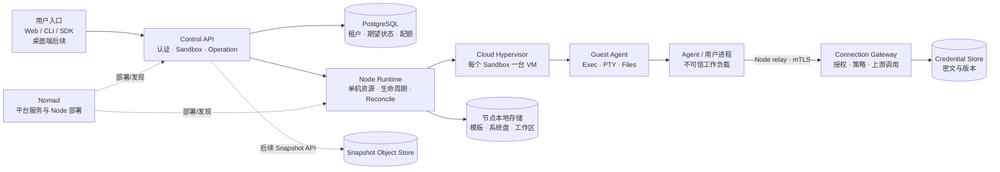

# Isodo 产品架构规格

状态：Draft v0.1 · 2026-10-24
范围：最终产品架构；当前交付先实现 Linux Cloud Hypervisor 沙箱服务。桌面端和 T3 工作台延后。

## 产品定位

Isodo 为个人用户提供安全、持久、可连接工具的 Agent 工作空间。用户以沙箱作为长期工作环境，在沙箱上下文中创建任务、运行 Agent、查看执行过程与文件产出，并授权该沙箱访问外部服务。控制面管理资源和操作；不可信 Agent 与用户进程运行在 Guest VM 中；第三方凭证由沙箱外的 Gateway 在授权后使用。

最终产品支持本地和云端沙箱，但当前服务路线只定义 Linux + Cloud Hypervisor 云端/服务端 Runtime。桌面端、本地虚拟化后端、T3 工作台不是当前服务 P0 的前置条件。

## 产品对象

| 对象 | 责任与关系 | 当前实现边界 |
| --- | --- | --- |
| Account / Tenant | 用户身份、套餐权益、凭证库的所有者；沙箱和连接按租户隔离。 | 当前正式认证、套餐与账单未实现。 |
| Sandbox | 用户拥有的隔离工作环境，绑定运行位置、模板、资源、持久工作区和安全策略；可承载多个任务。 | 服务 P0：服务端 Linux VM、生命周期、磁盘与网络。 |
| Task | 在某个沙箱中开展的一次工作，未来汇集对话、Agent 运行、审批、终端引用和产出。 | 桌面工作台规格延后；当前 API 不把 Task 当成 Sandbox。 |
| Agent / Process | 用户选择并运行在 Guest 内的 Agent 或普通程序。Agent 是沙箱中的不可信工作负载，不是控制面组件。 | Guest Agent 提供执行原语；Agent UI/会话编排不属于首个服务切片。 |
| Template | 可验证、不可变的沙箱起点，按版本和 digest 引用。 | P0 消费预构建镜像；通用构建器后续。 |
| Connection | 某 Sandbox 获准调用某外部服务的授权关系，限定可用凭证、策略和撤销状态。 | P0 做最小受控真实调用链路；广泛供应商兼容后续。 |
| Credential | 租户凭证库中的秘密版本；秘密值只由 Gateway 或专门 secret store 读取。 | 真实凭证库及密钥轮换尚未实现。 |
| Snapshot | 文件和环境在指定时刻的不可变版本；不包括运行中内存。上传后能创建独立 Sandbox，连接需要重新授权。 | 产品快照和对象存储后续；当前 Stop 保留原节点磁盘不等于 Snapshot。 |
| Plan | Free / Plus / Pro 等账户权益，限制云端计算和快照存储。 | 原型中的额度是 mock，不是正式资源承诺。 |

术语与产品关系见[产品概念](../docs/product-context.md)。产品交互原型中的模拟行为见[产品决策](../docs/product-decisions.md)。

## 架构视图

### 产品责任边界

- **产品入口**负责展示用户拥有的 Sandbox、Task 和连接授权。入口不直接访问 Node、CHV socket 或节点磁盘；操作结果以服务端 operation 和 observed state 为准。
- **Control API**是租户、鉴权、配额、Sandbox desired state 和异步 operation 的权威入口。它选择 Node 并调用 Node RPC，不操作宿主机资源。
- **Node Runtime**在单台 Linux/KVM 宿主负责本机 Sandbox VM、CHV 生命周期、实例磁盘、宿主网络策略和恢复。每个 Sandbox 同时只有一个有效 owner/generation。
- **Cloud Hypervisor VM**提供 Guest Kernel 边界。每个 Sandbox 一台 VM；Node 通过本机受保护的 CHV API 管理 VM，通过 Vsock 连接 Guest Agent。
- **Guest Agent**只管理 Guest 内进程、PTY 和文件。它不持有 CHV 控制权、宿主路径、平台长期凭证或其他 Sandbox 的身份。
- **Agent / 用户进程**是沙箱内不可信负载。它通过受控的 Guest 功能访问文件和进程，通过 Node 到 Gateway 的受限中继调用获批外部服务。
- **Connection Gateway**位于 Guest/Agent 信任边界之外。它校验 Sandbox 身份、连接授权、策略和凭证版本，再调用固定适配的上游服务。普通公网访问不代表拥有凭证权限。
- **Storage**分为控制状态、节点临时/持久运行盘和未来对象快照。控制状态不代替本地 VM 证据；节点失联不证明 VM 已停止。
- **Nomad**部署 API/Gateway service job 与 Node system job；不以每个 Sandbox 一个 Nomad Job 的方式创建工作负载。

### 部署形态

| 最终形态 | 计算位置 | 控制面 / 数据流 | 阶段 |
| --- | --- | --- | --- |
| 云端 Sandbox | Linux/KVM 节点上的 Cloud Hypervisor VM。 | Web/CLI/SDK → Control API → Node → Guest；受控连接经 Gateway。 | 当前服务目标。 |
| 本地 Sandbox | 用户设备上的平台虚拟化后端，复用 Sandbox/Guest 产品契约。 | 桌面端本地控制服务；凭证与云端账户的本地/远程安全关系需另行定义。 | 后续规格与实现。 |
| Task 工作台 | Web/桌面入口呈现对话、Agent 过程、审批和产物。 | Task 关联 Sandbox、进程 ID、事件与文件；工作台不越权控制 VMM。 | 后续产品阶段。 |
| Snapshot 到云端 | 从停止或一致化的 Sandbox 文件/环境制成对象存储工件。 | Snapshot 建立独立 Sandbox；新 Sandbox 重新授权连接。 | 后续产品阶段；不能与 Stop 保盘混称。 |

## 核心用户路径

1. 用户选择用途 Template、运行位置和资源，Control API 校验租户配额并创建异步 operation。
2. Control API 选择 Node。Node 从不可变 Template 准备实例盘与网络、启动 CHV，并等待 Guest Agent Ready；只有真实状态满足条件后 Sandbox 才报告 `running`。
3. 用户在 Sandbox 中启动 Agent 或其他进程。Guest Agent 返回稳定 execution ID；客户端断连只断开观察，不隐式杀掉进程。
4. Agent 读取/写入 Sandbox 文件或调用 PTY。对外服务请求经 Node relay 到 Gateway；Gateway 按 Sandbox 和 Connection 授权决定是否提供凭证并转发。
5. Stop 结束运行态但保留原节点工作盘；Start 冷启动并产生新 boot generation。Delete 结束 VM 并回收实例盘。产品 Snapshot 是另外的可恢复工件，不借用 Stop 语义。
6. 后续产品可把文件与环境保存为 Snapshot，上传后建立独立云端 Sandbox。Snapshot 不保存内存，凭证和连接授权不随工件复制。

## 服务 P0 / 延后范围

| 范围 | 必须提供的行为 | 明确不代表 |
| --- | --- | --- |
| Sandbox 控制 | Create/List/Get/Start/Stop/Delete、身份与租户隔离、配额、operation、幂等及失败补偿。 | 生产账单、自动扩缩容或跨节点无损迁移。 |
| Guest 运行时 | 命令执行、真实退出状态、超时/取消、PTY 输入/输出/resize、受限文件传输。 | Task 对话 UI 或通用 Agent 安装/升级平台。 |
| VM 与磁盘 | 每个 Sandbox 独立 CHV VM；不可变模板、本地可写盘、Stop 后保留、Delete 后清理；Node 重启可恢复管理。 | 云端备份、跨节点挂载或运行态恢复。 |
| 网络与连接 | 默认公网出口；宿主、内网、link-local/元数据被阻止；最小真实模型与 MCP 调用在 Guest 外授权。 | 所有协议、所有服务和任意 MCP 的兼容保证。 |
| 运维 | Nomad 部署控制服务和 Node；健康、日志、审计、资源回收与可验证恢复。 | 用户 Sandbox 作为 Nomad Job 管理。 |
| 产品桌面层 | 先以 API 和测试客户端验收服务。 | 桌面端、T3 工作台、本地 VZ、套餐支付或正式账号登录属于当前 P0。 |

详细执行语义分别由[服务行为](service-behavior.md)、[生命周期](sandbox-lifecycle.md)、[Guest 协议](guest-protocol.md)、[网络安全](network-security.md)和[模板存储](template-storage.md)定义。若本文件与详细契约不一致，以更具体、已核对的领域规格为准，并同步修订本文件。

## 信任与数据边界

1. 控制面身份与 Node mTLS 身份必须绑定；公开 API Token 不能作为 Node 身份使用。
2. Node 的 CHV API socket 只允许本机受控进程访问。Guest 不挂载宿主目录、不访问 KVM 或 VMM 控制 socket。
3. Guest/Agent 不接收平台永久凭证。Gateway 仅在验证租户、Sandbox、Connection、策略和密钥版本后访问秘密。
4. Sandbox 工作盘属于单个 Sandbox 与明确 owner generation。Snapshot/Template 是不可变对象，不因实例删除而误删。
5. 生命周期控制面状态和真实 CHV/Guest 状态分开记录。网络断连、API 超时和 Node 失联不能伪装成 VM 已停止。
6. 安全声明必须由负例验证支持。规格文本、CHV 启动探针和 protobuf 编译都不能单独证明多租户生产安全。

## 验收口径

- 用接口与真实 VM 证据覆盖一条完整的 Sandbox Create → Guest Ready → Exec/PTY/Files → Stop/Start → Delete 链路。
- 验证控制面超时/重启、Node 进程重启、重复请求、陈旧 generation、Guest 不可用及清理失败后的最终一致性。
- 使用真实目的地址测试公网允许、禁用出口、宿主/私网/元数据拒绝、IPv6 策略和 Connection 独立授权。
- 至少一种真实模型调用和一种真实 MCP 工具调用验证凭证不进入 Guest、审计可关联、授权撤销会拒绝后续调用。
- 交付文档标出每项的实现版本、复现命令、证据链接和未测限制。当前已通过的有限探针见[验证记录](validation.md)。
